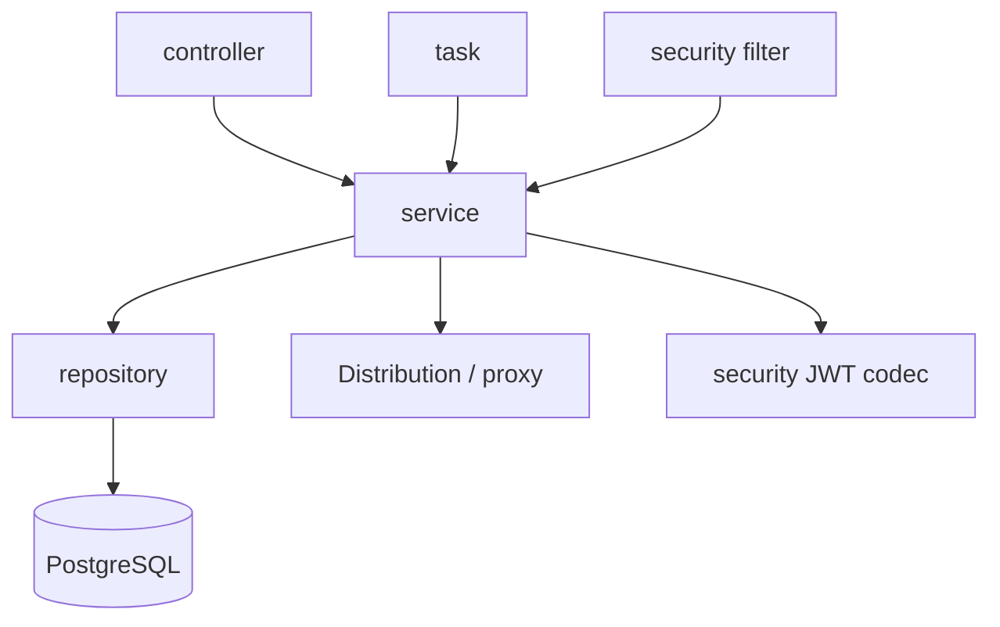

# Architecture Overview

This document defines the required architecture and Java constraints. Implementation must follow these boundaries;
existing code does not establish an architectural exception.
[DESIGN.md](DESIGN.md) indexes component contracts; `docs/spec/` defines wire protocols.

## System boundaries

| Area | Decision |
|---|---|
| Runtime | Java 25, Spring Boot, PostgreSQL; JVM and GraalVM Native Image |
| Entry point | `com.grallum.application.Application` is the bootstrap class; `Application.class` is its class literal |
| Build | `application/` is independently buildable; the root Maven project aggregates it |
| Browser UI | Spring MVC + Thymeleaf renders pages; JavaScript is optional enhancement |
| Authentication | JWT access tokens, current account/grant checks, and CSRF for cookie-authenticated requests |
| Image storage | Distribution owns local image bytes; PostgreSQL owns application metadata |
| Modes | PRIVATE image storage and PROXY public-image caching; public proxy writes are forbidden |
| Deployment | One application instance coordinates repository operations; storage endpoints are internal |
| Configuration | Typed Spring configuration properties; infrastructure settings in deployment YAML |
| Schema | Flyway migrations; applied migrations are immutable |

## Package structure and responsibility

Only `Application` belongs directly in `com.grallum.application`. The following packages are mandatory destinations,
not optional labels for classes left in the root package. Class names express business meaning and Java responsibility.

```text
com.grallum.application
  Application
  controller/   HTTP and server-rendered page entry points
  service/      Business use cases and coordination
  repository/   PostgreSQL access
  entity/       Database record representations
  dto/          Request, response, and page-view data
  model/        Business values, enums, and internal operation results
  config/       Spring wiring and typed configuration
  security/     JWT codec, authentication filters, and security-context adaptation
  task/         Scheduled entry points
  exception/    Typed failures and HTTP error mapping
```

| Package | Examples | Boundary |
|---|---|---|
| `controller` | `DockerGatewayController`, `DockerRepositoryController`, `DockerCleanupController`, `UserAuthController` | Bind and validate input, call services, render/write responses; no SQL, repository access, backend HTTP, or locks |
| `service` | `DockerGatewayService`, `DockerStorageService`, `DockerProxyService`, `DockerCleanupService`, `UserAuthService` | Authorize and execute use cases, own transactions/resource lifetimes; no Servlet request/response or controllers |
| `repository` | `DockerRepository`, `DockerTagObservationRepository`, `UserRepository` | Parameterized database access and atomic persistence operations; no HTTP, token signing, or permission policy |
| `entity` | `DockerRepositoryEntity`, `UserEntity`, `DockerCleanupRunEntity` | Persistence data, never returned directly as HTTP responses |
| `dto` | `DockerRepositoryResponse`, `DockerCleanupPolicyRequest`, `UserLoginRequest` | Explicit external data contracts; no business logic or database access |
| `model` | `DockerRepositoryRef`, `DockerOperation`, `AuthenticatedUser` | Typed internal values; no Spring MVC or JDBC dependency |
| `config` | `DockerProperties`, `JwtProperties`, `SecurityConfig`, `NativeConfig` | Validated settings, bean wiring, security chains, native hints |
| `security` | `JwtAuthenticationFilter`, `JwtTokenCodec` | Credential extraction, JWT encoding/verification, mapping a verified identity to Spring Security |
| `task` | `DockerCleanupTask` | Trigger service operations with an explicit system identity; no SQL or duplicated cleanup rules |
| `exception` | `BusinessException`, `HttpErrorWriter`, `ManagementExceptionHandler` | Typed failure categories and surface-specific status/body mapping |

Do not add generic gateway, client, interfaces, port, or adapter package hierarchies. Use concrete business classes
inside the packages above. Shared types have one owning component design and are referenced elsewhere.

## Dependencies and execution boundaries



Controllers and scheduled tasks call services; services call repositories or the specific storage/proxy service.
Only repository classes access JDBC. Only `DockerStorageService` and `DockerProxyService` perform image-backend HTTP.
Authorization belongs to `UserAuthorizationService`, not repositories or hidden UI buttons.
Services receive typed identities and business values, not `Authentication`, `HttpServletRequest`, or `Store.Repo`.

Transactions are owned by service operations and remain short. No SQL transaction spans image streaming or external
storage deletion. A database rollback cannot undo an external deletion. Cleanup must persist and reconcile uncertain
results. `DockerRepositoryLockService` provides shared repository coordination for the single-instance deployment.

The former catch-all `Store`, `ManagementApi`, direct controller SQL, and generic transport interfaces are not
supported architectural patterns. Do not reintroduce those shapes under new names.
Target method declarations, data ownership, failure behavior, and call chains are defined in the component designs.

Templates live in `src/main/resources/templates/`; static assets live in `src/main/resources/static/`.

## Java writing rules

| Rule | Requirement |
|---|---|
| Packages and names | Lowercase packages; UpperCamelCase classes; lowerCamelCase methods; business name plus role suffix |
| Files | One public top-level type per matching filename; shared DTO/entity/model types belong in their packages |
| Indentation | 2 spaces per level; Tab inserts spaces; hard tabs are forbidden |
| Continuations | Consistent 4-space continuation or aligned continuation |
| Line length | At most 120 characters, including imports, strings, and documentation |
| Javadoc | Every declared type and method/constructor; describe responsibility, parameters, result, effects and failures |
| Dependencies | Constructor injection; no exposed JDBC/HTTP fields or service-locator access |
| Contracts | Typed parameters/results; do not use arbitrary method/path strings or `Map<String,Object>` as business APIs |
| Secrets | No passwords, tokens, private keys, or image bodies in logs or generated `toString()` output |

`.editorconfig` sets editor defaults. Checkstyle checks main and test sources during Maven `validate`:

```sh
./scripts/lint.sh
mvn validate
mvn -f application/pom.xml spotless:apply
```

Lint enforces formatting and documentation. `ArchitectureTest` additionally checks package placement and forbidden
source dependencies. Neither replaces behavioral tests and integration acceptance. Skipping tests does not skip lint.

## Authority and completion

Root documents remain overviews. Component designs specify the target, and SPEC defines protocol semantics.
`docs/architecture.md` and `docs/api.md` explain implementation and usage; they cannot override these constraints.
A documented target is not implemented until code, migrations, tests, JVM/Native behavior, and acceptance evidence agree.
