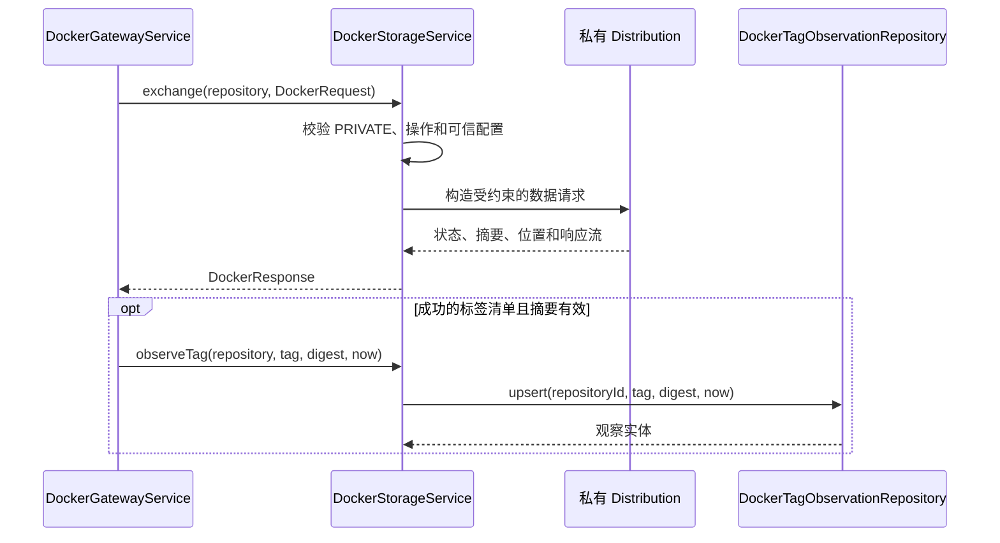

# 002 - Docker 镜像本地存储

状态：**规范契约；分层实现已落地，具体验收与平台边界见 [验证记录](../verification.md)**。

引用：[架构](../../ARCHITECTURE.md)、[001 网关与仓库管理](001-docker-registry-controller.md)、
[003 公共代理](003-public-registry-api-proxy.md)、[004 清理](004-scheduled-cleanup.md)、
[Registry API SPEC](../spec/docker-registry-api.md)。

## Context

持久保存私有 Docker/OCI 镜像和公共代理缓存，提供本地标签、清单、上传、引用删除及观察记录能力。
Distribution 管理镜像字节和内部布局，PostgreSQL 保存应用元数据；两者没有可回滚的共同事务。

### 目标类和存储归属

| 完整类名 | 职责 | 依赖边界 |
|---|---|---|
| `com.grallum.application.controller.DockerImageController` | 镜像标签 REST 入口 | DockerImageService，不依赖 Repository |
| `com.grallum.application.service.DockerImageService` | 页面与 REST 共用的已授权标签查看 | UserAuthorizationService、DockerRepositoryLockService、DockerStorageService、Clock |
| `com.grallum.application.service.DockerStorageService` | 私有镜像交换、本地元数据和观察同步 | DockerProperties、DockerTagObservationRepository、JDK HttpClient；不依赖 Controller |
| `com.grallum.application.repository.DockerRepository` | repository 表的查询和注册 | JdbcClient；不授权、不进行 HTTP |
| `com.grallum.application.repository.DockerTagObservationRepository` | tag_observation 的原子观察更新 | JdbcClient；不决定保留策略 |
| `com.grallum.application.entity.DockerRepositoryEntity` | 注册仓库数据 | 仅数据库字段 |
| `com.grallum.application.entity.DockerTagObservationEntity` | 标签观察数据 | 仅数据库字段 |
| `com.grallum.application.config.DockerProperties` | 可信端点、模式、超时及元数据上限 | 配置绑定和启动校验 |

`DockerRepository` 是数据库访问类，名称中的 Repository 表示持久化职责；镜像存储业务由 DockerStorageService 执行。
实体不得直接序列化给浏览器。配置不得由普通 API 请求更改为任意 URL。

| 数据 | 所有者 | 持久化位置 |
|---|---|---|
| 私有 blob、清单、引用和上传临时状态 | 私有 Distribution | 独立私有持久卷 |
| 公共缓存内容及引用 | 代理 Distribution 与本地管理 Distribution | 共用缓存卷，与私有卷分离 |
| 注册仓库 | DockerRepository | PostgreSQL repository |
| 标签当前摘要观察时间 | DockerTagObservationRepository | PostgreSQL tag_observation |

## Contract

### 共享模型、实体和分页类型

这些类型是所有设计共用的唯一声明；不使用持久化类的嵌套 Repo 作为跨层接口。

| 完整类型名 | 字段或取值 | 约束 |
|---|---|---|
| `com.grallum.application.model.DockerRepositoryName` | `String registry, String name` | 两者非空，name 不含 alias；外部名称为 registry/name |
| `com.grallum.application.model.DockerRepositoryRef` | `long id, DockerRepositoryName name, DockerRegistryMode mode` | 已注册的正 id；mode 来自可信配置，不从请求绑定 |
| `com.grallum.application.model.DockerRegistryMode` | PRIVATE、PROXY | 不接受未知或隐式默认模式 |
| `com.grallum.application.model.PageQuery` | `int size, Optional<String> after` | 外部分页 1～1000，默认 100；游标不能提供目标 URL |
| `com.grallum.application.dto.PageResponse<T>` | `List<T> items, Optional<String> next` | 不可变集合，next 仅指下一页游标 |
| `com.grallum.application.model.DockerManifest` | `String digest, String mediaType, boolean index, List<DockerManifestReference> references` | 元数据完整校验后返回；普通清单 references 为空 |
| `com.grallum.application.model.DockerManifestReference` | `String digest, String mediaType` | 子清单摘要与类型，用于索引依赖保护 |
| `com.grallum.application.model.DockerTaggedManifest` | `String tag, DockerManifest manifest` | 已完成读取的标签和对应清单 |
| `com.grallum.application.model.DockerTag` | `String tag, String digest, Instant firstSeen, boolean index` | 当前摘要的保守首次观察时间 |
| `com.grallum.application.model.DockerDeleteResult` | DELETED、ALREADY_ABSENT | 仅确认的本地删除结果；网络不确定不能伪装为任一值 |
| `com.grallum.application.entity.DockerRepositoryEntity` | `long id, String registry, String name` | repository 表；不包含用户权限或 HTTP 路径 |
| `com.grallum.application.entity.DockerTagObservationEntity` | `long repositoryId, String tag, String digest, Instant firstSeen` | tag_observation 表；不携带镜像内容 |

JDK 集合和 Optional 均非 null。DTO、model、entity 分别位于对应包的独立文件，不藏在 Controller 或 Service 里。

### DockerStorageService 精确方法

| 方法声明 | 输入、结果和副作用 |
|---|---|
| `public DockerResponse exchange(DockerRepositoryRef repository, DockerRequest request);` | 已授权且持有仓库 lease 的 PRIVATE 数据操作；借用请求流，返回调用方必须关闭的响应 |
| `public PageResponse<String> listTags(DockerRepositoryRef repository, PageQuery page);` | 单页本地标签；PRIVATE 使用本地端点，PROXY 必须使用管理端点 |
| `public List<String> listAllTags(DockerRepositoryRef repository);` | 完整本地枚举供清理；中途失败不返回部分集合，最多 100000 标签 |
| `public DockerManifest readManifest(DockerRepositoryRef repository, String reference);` | 标签或摘要；返回验证后的本地元数据，不回填公共上游 |
| `public DockerDeleteResult deleteManifest(DockerRepositoryRef repository, String digest);` | 已授权和协调的本地摘要删除；不直接回收共享字节 |
| `public Instant observeTag(DockerRepositoryRef repository, String tag, String digest, Instant observedAt);` | 原子更新观察，返回实际 firstSeen；同摘要不重置 |
| `public List<DockerTag> synchronizeObservations(DockerRepositoryRef repository, List<DockerTaggedManifest> completeTags, Instant observedAt);` | 仅接收完整快照，更新观察后返回业务标签；失败不用于清理 |

DockerRequest/Response 由 001 定义。该服务不接受 Authentication、Servlet、任意 HTTP 方法或任意 suffix/URL 参数。
后端路径由受约束操作、规范引用和可信配置生成，不开放通用 HTTP 代理接口。
本地读取缺失清单是 NOT_FOUND；超限、损坏、截断和网络故障是明确依赖错误，不返回空 Manifest。

### 镜像查询入口方法

| 类 | 精确声明 | 契约 |
|---|---|---|
| DockerImageController | `public PageResponse<DockerTagResponse> tags(AuthenticatedUser user, long repositoryId, PageQuery page);` | GET /api/repositories/{id}/tags；只绑定、校验和调用服务 |
| DockerImageService | `public PageResponse<DockerTagResponse> tags(AuthenticatedUser user, long repositoryId, PageQuery page);` | 当前 READ；获取仓库 lease 后读取本地标签页和清单，转换 DTO，finally 释放 |

`com.grallum.application.dto.DockerTagResponse` 字段为 `String tag, String digest, Instant firstSeen, boolean index`。
分页查询只对本页调用 observeTag，绝不以一页结果调用 removeMissing；后者只用于完整快照。
DockerRepositoryPageController.detail 同样调用 DockerImageService.tags 展示标签，不调用其他 Controller。
该接口目标返回 PageResponse，旧实现的裸列表不再作为分页契约；客户端需要读取 items 和 next。

### Repository 精确方法

| 所属类 | 方法声明 | 数据库语义 |
|---|---|---|
| DockerRepository | `public Optional<DockerRepositoryEntity> findById(long id);` | 不存在返回空，不包含 HTTP 404 决策 |
| DockerRepository | `public Optional<DockerRepositoryEntity> findByName(DockerRepositoryName name);` | 按 registry/name 唯一查询 |
| DockerRepository | `public DockerRepositoryEntity insert(String registry, String name);` | 由已授权服务调用，唯一性由数据库保证 |
| DockerRepository | `public List<DockerRepositoryEntity> findVisible(UUID userId, boolean administrator, Optional<DockerRepositoryName> after, int limit);` | 按服务已确定的可见范围和游标查询；允许 size+1 获取下一页信息 |
| DockerTagObservationRepository | `public DockerTagObservationEntity upsert(long repositoryId, String tag, String digest, Instant observedAt);` | 单条原子比较更新；同摘要保留 firstSeen |
| DockerTagObservationRepository | `public void removeMissing(long repositoryId, Set<String> presentTags);` | 仅在完整枚举及观察更新成功后使用 |
| DockerTagObservationRepository | `public void deleteByDigest(long repositoryId, String digest);` | 存储删除确认后的观察清理，不删除镜像 |

Repository 只返回实体或明确数据结果。当前权限、可见范围和 HTTP 状态由 service 决定，
Controller 不得传一个 administrator=true 直接调用查询；控制器根本不能注入该 Repository。

### 配置和资源约束

DockerProperties 绑定现有 `app.registries` 配置，并以类型化嵌套配置表示超时和大小限制；新增设置须明确绑定和验收。

| 配置或对象 | 约定 |
|---|---|
| alias.url / alias.mode | 必填可信数据端点和 PRIVATE/PROXY 模式 |
| alias.management-url | 本地管理端点；PRIVATE 缺省可使用 url，PROXY 不允许回退 DATA |
| 连接 / 元数据 / 流超时 | 默认 10 秒 / 60 秒 / 30 分钟，采用 Duration，不散落魔法常量 |
| 元数据大小 | 目标 `app.registry.metadata-max-bytes` 默认 8 MiB；读取过程中限制，不能先收完再检查 |
| 正文 | 只有镜像内容使用流；标签和清单元数据使用受限解码 |
| 摘要和媒体类型 | 只支持 SPEC 的 SHA-256、Docker schema-2、OCI 镜像清单和索引 |
| 删除 | 确认 202 为 DELETED；已确定本地路径的删除 404 可为 ALREADY_ABSENT；其余失败不能算成功 |
| 锁 | 最外层网关/清理服务持有仓库 lease；本服务不重复获取，也不跨线程偷偷释放 |
| 事务 | 观察操作为短数据库操作；不跨镜像请求持有 SQL 事务 |

观察同步采用有界数据库操作；只有完整读取且更新成功后才移除缺失标签。
若后端成功而观察写入失败，应留下待核对结果，不声称后端写入已撤销。
原有控制器直接写观察表、返回 HttpResponse 给上层业务以及暴露通用 metadata 方法的结构必须整改。

## Core Logic

### 私有镜像调用链



开始上传、分块、摘要校验及提交由 Distribution 完成；Java 服务保护输入、权限边界和流资源，
不重新实现文件格式或通过直接文件删除绕过引用规则。

### 本地元数据与清理调用链

```text
DockerCleanupService.preview/run
  -> DockerStorageService.listAllTags
  -> DockerStorageService.readManifest（含索引依赖校验）
  -> DockerStorageService.synchronizeObservations
     -> DockerTagObservationRepository.upsert / removeMissing
  -> 类型化 DockerTag 集合

DockerCleanupService.run
  -> DockerStorageService.deleteManifest（本地管理端点）
  -> DockerCleanupService 的确认事务
     -> DockerTagObservationRepository.deleteByDigest
     -> DockerCleanupRunRepository 记录确认 + AuditService.record
```

PROXY 的元数据和删除始终选择共享缓存卷的内部管理 Distribution，它没有公共上游配置。
新 Service 的签名不继承旧 Store.Repo 或 RegistryClient 的公开字符串转发方法；调用方需按目标模型迁移。

### 持久化生命周期

已提交镜像在应用和后端重启后可读；未完成上传可恢复或按后端规则过期。
逻辑删除与物理 GC 分离。离线缓存 GC 前停止所有写入、回填、调度以及代理和管理两个进程。
备份恢复必须覆盖匹配的 PostgreSQL 与镜像卷快照，验证引用和摘要后才开放写入。

## Corners

| 场景 | 要求 |
|---|---|
| 空仓库 | listTags/listAllTags 返回空集合；不能把依赖失败转换为空 |
| 缺管理 URL | PROXY 管理操作 UNAVAILABLE，不尝试 DATA 或公共源 |
| 非法引用、摘要或模式 | 网络访问前拒绝，无默认仓库回退 |
| 元数据超限、非法 JSON、重复分页游标 | 整次读取失败，不交付用于删除的部分快照 |
| 多架构依赖缺失或异常 | 清理停止；不能把无法解析解释为无依赖 |
| 同摘要重复观察 | 保持 firstSeen；新摘要重新计龄 |
| 磁盘满、只读卷、错误摘要 | 不提交无效内容，原提交对象保持可读 |
| 删除响应丢失 | 返回不确定依赖失败，由 004 对账，禁止自动重放后声称一次成功 |
| 枚举或观察同步中断 | 不移除缺失记录，不生成清理候选 |
| 停机和取消 | 流关闭，在途上传保留后端恢复语义，不虚报完成 |

验收需验证包依赖、实体与 DTO 隔离、真实推拉和续传、共享引用、元数据上限、重启、磁盘故障及受控恢复。
仅 SQL 迁移或格式 lint 不能证明内容持久化和跨组件一致性。
