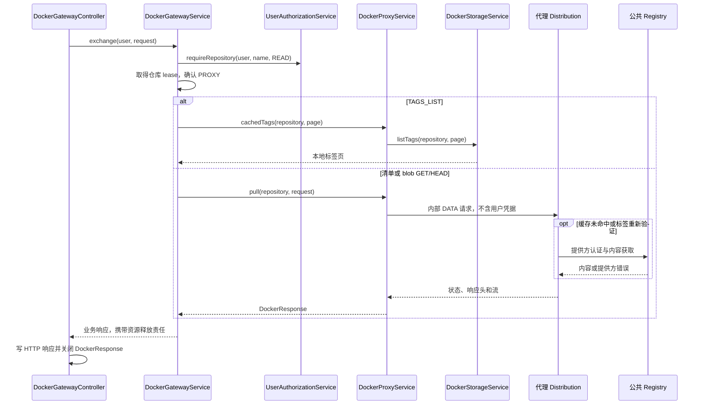

# 003 - Docker 公共镜像代理

状态：**规范契约；分层实现已落地，具体验收与平台边界见 [验证记录](../verification.md)**。

引用：[架构](../../ARCHITECTURE.md)、[001 网关](001-docker-registry-controller.md)、
[002 存储与模型](002-local-image-storage.md)、[004 清理](004-scheduled-cleanup.md)、
[005 授权](005-user-login.md)、[Registry API SPEC](../spec/docker-registry-api.md)。

## Context

让已授权用户从 Grallum 拉取配置好的公共镜像，并利用本地缓存。它是 Docker 镜像代理业务，
不是接受任意 URL、HTTP 方法或凭据的通用转发工具。

### 类和所有权

| 完整类名或组件 | 职责与边界 |
|---|---|
| `com.grallum.application.service.DockerProxyService` | 公共镜像读取及本地缓存标签访问；依赖 DockerProperties、DockerStorageService、配置的 JDK HttpClient |
| `com.grallum.application.service.DockerGatewayService` | 调用代理前完成身份、当前权限、模式和仓库协调；由 001 定义 |
| `com.grallum.application.service.DockerStorageService` | 代理缓存的本地元数据与删除；由 002 定义 |
| `com.grallum.application.config.DockerProperties` | 可信 alias、数据与管理端点；不得从客户端请求拼出任意主机 |
| 代理 Distribution | 公共提供方认证、内容拉取和缓存落盘 |
| 内部管理 Distribution | 与代理共享缓存卷，不配置公共上游，只处理本地元数据和删除 |

DockerProxyService 不依赖 Controller、Repository 或 Servlet，不拥有用户数据库，不签发本地用户 JWT。
HTTP 入口仍为 controller.DockerGatewayController，不再增加同职责代理控制器或 client 包。
共享 DTO、model 直接引用 001/002，不能复制一套名称不同但语义相同的数据类型。

## Contract

### Java 方法契约

| 所属类 | 精确声明 | 输入、结果和副作用 |
|---|---|---|
| DockerProxyService | `public DockerResponse pull(DockerRepositoryRef repository, DockerRequest request);` | 已授权并持有仓库 lease 的 PROXY 读取；返回可关闭响应，可能回填本地缓存 |
| DockerProxyService | `public PageResponse<String> cachedTags(DockerRepositoryRef repository, PageQuery page);` | 只列本地缓存标签，委托 DockerStorageService.listTags；不回填 |

构造器注入 DockerProperties、DockerStorageService 和受配置约束的 JDK HttpClient，不执行网络请求。
以上 public 方法都必须校验模式和输入一致性；它们只供业务服务调用，不能被 Controller 绕过授权直接调用。

| DockerRequest 操作 | 允许方法 | 执行结果 |
|---|---|---|
| MANIFEST_READ | GET/HEAD | 经内部代理 DATA 获取协商后的清单或响应头 |
| BLOB_READ | GET/HEAD | 经内部代理 DATA 流式读取，可处理 Range |
| TAGS_LIST | GET | 网关服务调用 cachedTags；不会进入公共 tags/list |
| 其他操作 | 无 | UNSUPPORTED，无后端网络调用；管理员也不能推送或删除公共上游 |

DockerRequest 的操作、规范仓库身份和引用由 001 定义；不提供 `pull(String url, String method)` 或任意 suffix 方法。
服务自己根据受约束模型生成请求路径。DockerResponse 的关闭责任沿调用链交给最终 HTTP 入口。

### 输入输出和配置

| 项目 | 约束 |
|---|---|
| 仓库名 | 外部 alias/name；上游只使用 name，Docker Hub 的 library/ 需显式保留 |
| 模式 | DockerProperties 中明确 PROXY；缺少配置不得回退到公共默认仓库 |
| 数据端点 | 内部代理 Distribution 的 url；公共 remoteurl 由部署配置，不能由用户提供 |
| 管理端点 | 必须为共享缓存卷的内部 management-url；缺失则本地管理不可用 |
| 用户凭据 | Authorization、Cookie、用户密码和 JWT 不发送给公共提供方或存储进程 |
| 请求头 | 保留多个 Accept、Range 和允许的条件请求头；不转发 hop-by-hop 头 |
| 响应 | 保留安全的媒体类型、摘要、范围、状态及 Retry-After；链接外部化由网关响应适配完成 |
| 标签分页 | PageQuery 默认 100、最大 1000，结果仅代表本地缓存 |
| 缓存 TTL | Distribution proxy.ttl 为 0s，避免和应用保留策略冲突 |
| 超时 | 使用 002 的连接和流超时配置，不在各方法中散落独立常量 |
| 重试 | 不无限重试；开始向调用者交付正文后不得重新发送并拼接另一响应 |

标签是可变引用，代理可能向上游重新验证；按摘要寻址内容不可变。
“已有部分 blob”不构成完整离线镜像承诺，离线标签解析和全部依赖须单独验收。

### 失败语义

| 来源 | 服务结果 |
|---|---|
| 输入不是 PROXY 或不是只读操作 | BusinessException(UNSUPPORTED/INVALID_INPUT)，网络前拒绝 |
| 连接失败 | DEPENDENCY_FAILURE；超时为 TIMEOUT；最终由入口映射 502/503/504 |
| 公共内容 404 | 保留 SPEC 的清单或 blob 缺失语义 |
| 公共提供方 401/403 | 安全依赖错误，不能变成本地用户重新登录指令，也不透传提供方 challenge |
| 429 | 保留 429 和安全 Retry-After，交由客户端决定重试 |
| 本地标签管理失败 | 显式失败，不能使用上游全集或空集合伪装成功 |

映射使用 001 定义的 BusinessException/BusinessErrorCode 和 DockerResponse，禁止在此重新定义一套网关异常。
原先将所有请求都交给代理数据端点的做法必须改为明确的数据与管理分流；这是调用者可见的缓存列表修正。

## Core Logic

### 拉取调用链

公共提供方认证属于 Distribution，不在 UserAuthService 和 DockerProxyService 之间传递用户密码。
DockerProxyService 不获取第二把锁；它依赖调用服务已持有协调权，并防御检查模式和操作。

### 清理和管理协作

| 场景 | 方法链 | 结果 |
|---|---|---|
| 本地缓存标签 | DockerGatewayService.exchange → DockerProxyService.cachedTags → DockerStorageService.listTags | 只读管理端点，无公共标签枚举 |
| 本地缓存清理 | DockerCleanupService.run → DockerStorageService.deleteManifest | 只删除缓存引用，DockerProxyService 不暴露删除方法 |
| 清理后重新拉取 | DockerGatewayService.exchange → DockerProxyService.pull → 代理 Distribution | 合法内容可从公共源重新回填 |
| 页面展示 | DockerRepositoryPageController.detail → DockerRepositoryService.detail + DockerImageService.tags | 展示外部地址、PROXY 模式和本地缓存标签，不展示内部 URL |

所有页面调用业务服务，不通过 HTTP 回调自己或注入 Repository 查询缓存目录。
清理后的再次回填与删除须共用 001 定义的仓库协调服务。

## Corners

| 边界 | 可观察行为 |
|---|---|
| 空缓存 | cachedTags 返回空页，不为了展示而访问公共目录 |
| 无效 alias、路径或类型 | 网络前拒绝，不尝试猜测上游 |
| 没有管理端点 | 本地管理不可用，仍不能放宽为上游查询 |
| 摘要错误或截断 | 不视为成功内容；代理不提交有效缓存，客户端校验收到的字节 |
| 并发回填和清理 | 共享仓库 lease；不能使半成品成为缓存命中或删除新受保护引用 |
| 缓存命中但公共源中断 | 可用性取决于完整依赖和标签解析；不伪造成功 |
| 提供方重定向 | 仅允许部署策略批准的提供方/CDN 路径，不向客户端泄露内部地址 |
| 传输取消或停机 | 关闭在途流，停止新工作，保留已提交缓存；不重复拉取后拼接响应 |

验收包括非法写零网络调用、标签零 DATA 调用、用户凭据零上游泄露，以及真实多架构拉取、缓存复用、
标签变更、429/超时、删除后重拉。还需检查代理服务没有 Controller、Repository 或 Servlet 依赖。
