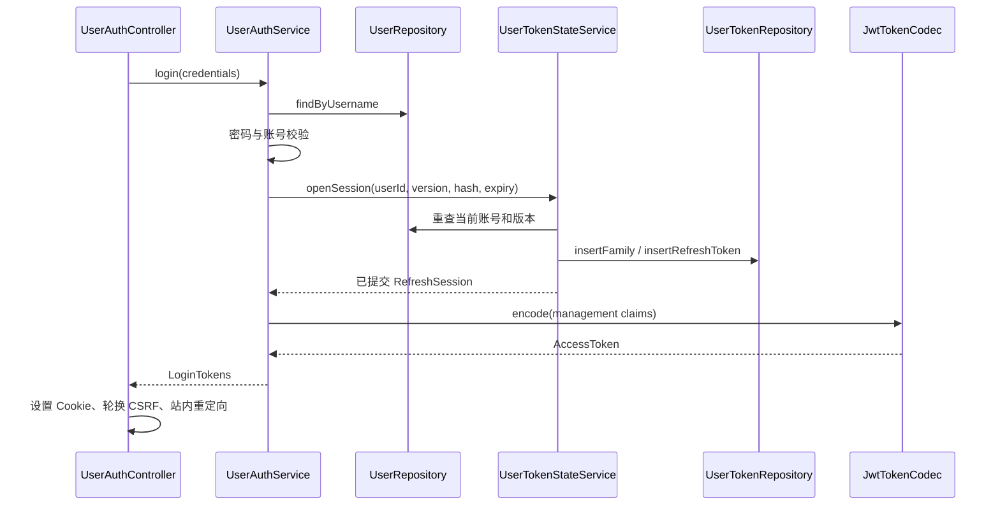

# 005 - 用户登录、JWT 与授权

状态：**规范契约；分层实现已落地，具体验收与平台边界见 [验证记录](../verification.md)**。

引用：[架构](../../ARCHITECTURE.md)、[001 Docker 入口](001-docker-registry-controller.md)、
[002 仓库模型](002-local-image-storage.md)、[Registry 认证 SPEC](../spec/docker-registry-api.md#authentication)。

## Context

分别支持浏览器、机器管理 API 和 Docker 客户端，统一执行当前账号、令牌状态及仓库权限检查。
浏览器使用 Spring MVC + Thymeleaf，登录、续期和注销无需 JavaScript；JWT 不等于无需数据库授权或撤销。

### 目标类与职责包

| 完整类名 | 职责与依赖 |
|---|---|
| `com.grallum.application.controller.UserAuthController` | 登录页面/表单、令牌交换、刷新、注销及 Cookie 输出；调用 UserAuthService |
| `com.grallum.application.controller.UserController` | 用户管理 REST；调用 UserManagementService |
| `com.grallum.application.controller.UserPageController` | 用户管理 Thymeleaf 页面；调用同一 UserManagementService |
| `com.grallum.application.controller.UserPermissionController` | 仓库授权 REST 和表单；调用 UserAuthorizationService |
| `com.grallum.application.service.UserAuthService` | 验证凭据、签发、认证、刷新和注销用例；依赖 UserRepository、UserTokenStateService、UserAuthorizationService、JwtTokenCodec、PasswordEncoder、Clock |
| `com.grallum.application.service.UserAuthorizationService` | 当前账号、管理员和仓库权限决策；依赖 UserTokenStateService、UserRepository、UserPermissionRepository、DockerRepository、DockerProperties、AuditService |
| `com.grallum.application.service.UserManagementService` | 创建/变更用户及凭据失效；依赖授权服务、UserRepository、UserTokenStateService、PasswordEncoder、AuditService |
| `com.grallum.application.service.UserTokenStateService` | 登录族、刷新消费、撤销和凭据版本的短事务 |
| `com.grallum.application.repository.UserRepository` | app_user 的参数化查询和更新；无 JWT 或权限策略 |
| `com.grallum.application.repository.UserPermissionRepository` | repo_permission 的数据访问；无授权决策 |
| `com.grallum.application.repository.UserTokenRepository` | 令牌族、刷新哈希、消费状态和撤销记录的数据访问 |
| `com.grallum.application.security.JwtTokenCodec` | 用可信配置和标准 Spring Security JWT 组件签名/验签，不访问数据库 |
| `com.grallum.application.security.JwtAuthenticationFilter` | 提取对应入口凭据，调用 UserAuthService，建立 Spring Security 上下文 |
| `com.grallum.application.config.SecurityConfig` | 安全链、CSRF、入口匹配与密码编码配置 |
| `com.grallum.application.config.JwtProperties` | 签名配置、受众、令牌时限和刷新生命周期 |
| `com.grallum.application.config.WebProperties` | 可信公共地址、Cookie 属性和站内重定向约束 |

UserTokenStateService 只依赖 UserRepository、UserTokenRepository、AuditService 和 Clock。
认证业务不进入 Filter/Repository，密码学不进入 Controller，控制器不能直接更新用户表。

## Contract

### 对外 HTTP 契约

| 方法与路径 | 输入 | 输出与保护 |
|---|---|---|
| GET `/login` | 无需登录 | auth/login 模板和 CSRF 状态 |
| POST `/login` | username/password、CSRF、站内 returnTo | 设置 HttpOnly Cookie，Post/Redirect/Get；不回显凭据 |
| POST `/auth/refresh` | 刷新 Cookie 和 CSRF | 轮换刷新与访问令牌，不要求旧访问 JWT 未过期 |
| POST `/auth/logout` | 刷新 Cookie 和 CSRF | 撤销本设备令牌族，清除 Cookie；重复退出可清除本地状态 |
| POST `/api/auth/token` | 显式非表单 JSON 用户名/密码 | 管理 Bearer，不创建浏览器 Cookie 或刷新族 |
| GET `/auth/registry/token` | HTTPS Basic、service 和 scope | SPEC 的 Registry 令牌响应；Basic 仅用于交换 |
| GET/POST `/api/users`，PUT `/api/users/{username}` | 当前管理身份和用户 DTO | 管理员操作，结果无密码哈希 |
| GET/PUT `/api/repositories/{id}/permissions`，DELETE 子用户路径 | 当前管理身份与授权 DTO | 当前 MANAGE，不能依赖客户端声明的角色 |

Registry 资源不接受 Cookie 或管理 JWT，管理资源不接受 Registry JWT。
缺少身份/无效凭据为 401，权限或 CSRF 失败 403，参数错误 400，限流 429；依赖不可用是服务错误，不能误报密码错误。

### 身份、令牌与 DTO 类型

| 完整类型名 | 字段或取值 | 边界 |
|---|---|---|
| `com.grallum.application.model.TokenAudience` | MANAGEMENT、REGISTRY | 映射 grallum-management / grallum-registry |
| `com.grallum.application.model.RepositoryPermission` | READ、WRITE、MANAGE | 有序权限，分别包含较低权限 |
| `com.grallum.application.model.RegistryAction` | PULL、PUSH、DELETE | 对应 SPEC action，不使用任意字符串扩权 |
| `com.grallum.application.model.RegistryScope` | `DockerRepositoryName repository, Set<RegistryAction> actions` | 解析后的请求范围 |
| `com.grallum.application.model.RegistryGrant` | 同上 | 仅包含当前授权与请求范围交集 |
| `com.grallum.application.model.JwtClaims` | `UUID subject, TokenAudience audience, long credentialVersion, UUID tokenId, Optional<UUID> familyId, Instant issuedAt, Instant notBefore, Instant expiresAt, List<RegistryGrant> grants` | 由服务签发或 Codec 验证后建立，不能从 JSON 直接绑定 |
| `com.grallum.application.model.AuthenticatedUser` | `UUID id, String username, boolean administrator, JwtClaims claims` | 安全链建立的可信身份；service 仍检查当前状态 |
| `com.grallum.application.model.UserCredentials` | username、password | 短生命周期秘密对象，不进入日志、实体响应或默认 toString |
| `com.grallum.application.model.AccessToken` | value、issuedAt、expiresAt | 内部秘密对象，不能输出到普通页面 |
| `com.grallum.application.model.LoginTokens` | AccessToken、refreshSecret、refreshExpiresAt | 仅服务向浏览器控制器交付 Cookie 所需数据 |
| `com.grallum.application.model.RefreshSession` | familyId、userId、credentialVersion、absoluteExpiresAt | 持久化事务确认后的登录族信息 |
| `com.grallum.application.model.RefreshRotation` | RotationStatus、Optional<RefreshSession> | 状态 ROTATED/REPLAY/EXPIRED/INVALID；失败不是有效会话 |
| `com.grallum.application.model.RotationStatus` | ROTATED、REPLAY、EXPIRED、INVALID | 先提交必要撤销，再对外报告失败 |
| `com.grallum.application.dto.UserLoginRequest` | username、password | JSON/表单验证；密码不回显 |
| `com.grallum.application.dto.TokenResponse` | token、access_token、expires_in、issued_at | 与 SPEC 一致，两个 token 值相同 |
| `com.grallum.application.dto.UserCreateRequest` | username、password、admin | 明确长度和唯一性约束 |
| `com.grallum.application.dto.UserUpdateRequest` | enabled、admin、可选 password | 缺省密码表示不修改，不能把空串当作省略 |
| `com.grallum.application.dto.UserResponse` | id、username、enabled、admin | 不返回 hash、credentialVersion、令牌状态或秘密 |
| `com.grallum.application.dto.UserPermissionRequest` | username、RepositoryPermission | 服务解析到稳定 userId，客户端不能直接指定内部角色 |
| `com.grallum.application.dto.UserPermissionResponse` | username、RepositoryPermission | 当前仓库授权视图 |

所有类型为对应包中的独立文件。含密码或令牌的类型不得使用会泄密的默认 record.toString；
使用普通类或显式覆盖 toString 的 record，必须返回明确脱敏表示。业务服务不接受 Servlet 或 Spring Authentication 类型。

### Entity 和配置

| 完整类型 | 关键数据 |
|---|---|
| `com.grallum.application.entity.UserEntity` | id(UUID，不复用)、username、passwordHash、enabled、administrator、credentialVersion |
| `com.grallum.application.entity.UserPermissionEntity` | repositoryId、userId、RepositoryPermission；仓库/用户唯一 |
| `com.grallum.application.entity.UserRefreshFamilyEntity` | id、userId、credentialVersion、absoluteExpiresAt、revokedAt |
| `com.grallum.application.entity.UserRefreshTokenEntity` | id、familyId、secretHash、expiresAt、consumedAt、replacementId |
| `com.grallum.application.entity.UserTokenRevocationEntity` | tokenId、expiresAt |

通过新 Flyway 迁移为现有用户分配稳定 id，并迁移授权关联，保留用户名、密码哈希和权限。
已有 Session 不转换为 JWT，客户端重新登录；内部身份不再用可重新分配的用户名作为 sub。

| 配置/声明 | 要求 |
|---|---|
| RS256 / kid / iss | RSA 至少 2048 位、可信固定算法和密钥、精确签发者；禁止 token 提供的 jku/x5u |
| JWT 时间 | iat/nbf/exp 必填 UTC；默认管理 10 分钟、Registry 5 分钟，时钟偏差最多 30 秒 |
| 当前状态 | 检查 enabled、credentialVersion、jti 撤销；浏览器额外检查 sid 族状态 |
| 刷新族 | 默认绝对有效期 7 天，随机秘密只保存哈希；过期消费记录保留到必要重放检测窗口结束 |
| Cookie | HttpOnly、Secure、SameSite=Lax、host-only；访问 Cookie 使用 Path=/ 的 __Host- 名称，刷新 Cookie 限定认证路径 |
| CSRF | 浏览器登录/刷新/注销及其他非安全请求均检查；Cookie JWT 不能关闭 CSRF |
| 配置绑定 | JwtProperties 对应 app.security.jwt；RefreshProperties 对应 app.security.refresh；WebProperties 对应可信 public-base-url 和 Cookie 设置，实施时明确绑定而非静默默认 |
| 生产边界 | 密钥缺失启动失败；仅显式回环开发配置允许非 Secure 开发 Cookie，生产不降级 |

### Controller 和安全入口方法

| 类 | 精确声明 | 职责 |
|---|---|---|
| UserAuthController | `public String loginPage(Model model);` | GET 登录页 |
| UserAuthController | `public String login(UserLoginRequest request, String returnTo, HttpServletResponse response, Model model);` | CSRF 后调用服务，写 Cookie，安全重定向 |
| UserAuthController | `public String refresh(HttpServletRequest request, HttpServletResponse response);` | 读取刷新 Cookie，服务成功后替换，支持无 JS |
| UserAuthController | `public String logout(HttpServletRequest request, HttpServletResponse response);` | 调用注销并清除 Cookie |
| UserAuthController | `public TokenResponse token(UserLoginRequest request);` | 机器 JSON 凭据交换，不能用环境 Cookie 代替密码 |
| UserAuthController | `public TokenResponse registryToken(String service, HttpServletRequest request, String authorization);` | 只在此入口绑定 Basic 头，转换为 UserCredentials 与 RegistryScope |
| UserController | `public List<UserResponse> list(AuthenticatedUser actor);` | 服务完成管理员检查 |
| UserController | `public UserResponse create(AuthenticatedUser actor, UserCreateRequest request);` | 委托用户业务 |
| UserController | `public UserResponse update(AuthenticatedUser actor, String username, UserUpdateRequest request);` | 委托用户业务 |
| UserPageController | `public String list(AuthenticatedUser actor, Model model);` | users/list 模板，复用用户业务 |
| UserPageController | `public String save(AuthenticatedUser actor, String username, UserUpdateRequest request, Model model);` | CSRF 表单，复用 update，成功 PRG |
| UserPermissionController | `public List<UserPermissionResponse> list(AuthenticatedUser actor, long repositoryId);` | 当前 MANAGE，由授权服务校验 |
| UserPermissionController | `public void grant(AuthenticatedUser actor, long repositoryId, UserPermissionRequest request);` | 委托授权业务 |
| UserPermissionController | `public void revoke(AuthenticatedUser actor, long repositoryId, String username);` | 委托授权业务 |
| JwtAuthenticationFilter | `protected void doFilterInternal(HttpServletRequest request, HttpServletResponse response, FilterChain chain) throws ServletException, IOException;` | 仅提取凭据、调用 authenticate、适配安全上下文；不查询数据库 |

scope 从 request.getParameterValues("scope") 逐项读取，不能让 Spring 把 action 中的逗号当作 List 参数分隔符。
Controller 对 Basic 只做输入格式解析，不验证密码或扩大 scope。Web 类型仅用于 controller、security filter、exception 映射和 config 的 Web/Security 适配，不能进入业务 Service/Repository。
SecurityConfig 分开匹配 Registry Bearer、管理 Cookie/Bearer 和显式凭据端点；不启用资源端点的 Basic 回退。
访问 JWT 过滤不得阻断登录/刷新/注销的独立凭据流程；这些浏览器 POST 仍受 CSRF 保护。
JWT 每次请求验签不能触发交互式登录的 CSRF 自动轮换；轮换由登录/刷新/退出控制器显式完成，
静态资源读取不会使已经渲染的表单失效。凭据交换按账号哈希每分钟最多 30 次，最多保留 10000 个活动限流键；
超过上限返回 429，限流数据不记录明文用户名、密码或刷新秘密。

### SecurityConfig 方法与匹配顺序

以下为包内配置 Bean 方法声明，均位于 config.SecurityConfig，不出现在业务 Service：

```java
SecurityFilterChain credentialSecurity(HttpSecurity http) throws Exception;
SecurityFilterChain dockerSecurity(HttpSecurity http, UserAuthService service) throws Exception;
SecurityFilterChain managementSecurity(HttpSecurity http, UserAuthService service) throws Exception;
PasswordEncoder passwordEncoder();
```

credentialSecurity 优先匹配显式凭据端点；浏览器登录、刷新、注销保留 CSRF，仅非环境凭据的机器交换按独立规则处理。
dockerSecurity 仅 /v2/**，配置 REGISTRY 过滤器和协议质询；managementSecurity 配置 MANAGEMENT 过滤器及页面/API错误区别。
JwtAuthenticationFilter 的构造签名为 `public JwtAuthenticationFilter(UserAuthService service, TokenAudience audience, WebProperties web);`，
audience 由配置固定，不能从请求参数选择。所有链不创建认证 HttpSession。

### 认证和授权 Service 方法

| 所属类 | 精确声明 | 契约 |
|---|---|---|
| UserAuthService | `public LoginTokens login(UserCredentials credentials);` | 验证密码与当前账号，创建族，签发管理令牌；持久化成功后返回 |
| UserAuthService | `public LoginTokens refresh(String refreshSecret);` | 原子轮换后签发；重放失败在撤销提交后抛出 |
| UserAuthService | `public void logout(String refreshSecret);` | 撤销对应族，未知或空秘密不泄露存在性 |
| UserAuthService | `public AccessToken managementToken(UserCredentials credentials);` | 只签发管理访问，不创建浏览器族 |
| UserAuthService | `public AccessToken registryToken(String service, List<RegistryScope> scopes, UserCredentials credentials);` | 密码和 service 校验后获取当前交集，不签额外权限 |
| UserAuthService | `public AuthenticatedUser authenticate(String token, TokenAudience expected);` | Codec 验证后检查数据库当前状态，返回可信身份 |
| UserAuthorizationService | `public AuthenticatedUser requireActive(AuthenticatedUser user);` | 重新检查当前状态，刷新当前角色快照；不能相信过时 administrator 值 |
| UserAuthorizationService | `public void requireAdministrator(AuthenticatedUser user);` | 当前管理身份及管理员权限 |
| UserAuthorizationService | `public DockerRepositoryRef requireRepository(AuthenticatedUser user, DockerRepositoryName name, RepositoryPermission permission);` | 当前 ACL、JWT 范围及模式检查；处理隐藏仓库存在性 |
| UserAuthorizationService | `public DockerRepositoryRef requireRepository(AuthenticatedUser user, long repositoryId, RepositoryPermission permission);` | 管理用例按 id 授权，返回规范仓库身份 |
| UserAuthorizationService | `public List<RegistryGrant> registryGrants(UUID userId, List<RegistryScope> requested);` | 仅供已验证凭据的签发用例调用，不是资源访问授权捷径 |
| UserAuthorizationService | `public List<UserPermissionResponse> permissions(AuthenticatedUser actor, long repositoryId);` | 当前 MANAGE，映射授权 DTO |
| UserAuthorizationService | `public void grant(AuthenticatedUser actor, long repositoryId, UserPermissionRequest request);` | 当前 MANAGE，短事务授权与审计 |
| UserAuthorizationService | `public void revoke(AuthenticatedUser actor, long repositoryId, String username);` | 当前 MANAGE，短事务撤销与审计 |
| UserManagementService | `public List<UserResponse> list(AuthenticatedUser actor);` | 管理员读取无敏感字段 DTO |
| UserManagementService | `public UserResponse create(AuthenticatedUser actor, UserCreateRequest request);` | 管理员检查、密码哈希、实体保存及审计 |
| UserManagementService | `public UserResponse update(AuthenticatedUser actor, String username, UserUpdateRequest request);` | 当前管理员，禁止自我停用/降级；与凭据失效同一事务 |
| JwtTokenCodec | `public AccessToken encode(JwtClaims claims);` | 固定可信签名配置，无数据库调用 |
| JwtTokenCodec | `public JwtClaims decode(String token, TokenAudience expected);` | 验签、受众、签发者和时间；不宣称数据库授权有效 |

### 状态事务与 Repository 方法

| 类 | 精确声明 | 数据与事务边界 |
|---|---|---|
| UserTokenStateService | `public RefreshSession openSession(UUID userId, long credentialVersion, String refreshHash, Instant expiresAt);` | 短事务重查账号/版本，创建族和首个秘密哈希 |
| UserTokenStateService | `public RefreshRotation rotate(String presentedHash, String replacementHash, Instant now);` | 短事务串行消费；重放分支撤销族并正常返回 REPLAY，使事务提交 |
| UserTokenStateService | `public void revokeFamily(String refreshHash, Instant now);` | 查对应族，撤销及审计；未知秘密幂等 |
| UserTokenStateService | `public void invalidateUser(UUID userId);` | 版本递增和族撤销，加入用户更新事务 |
| UserTokenStateService | `public UserEntity requireActive(JwtClaims claims);` | 内部服务读取当前账号、版本、撤销和族；返回实体仅供服务映射 |
| UserRepository | `public Optional<UserEntity> findById(UUID id);` | 数据查询 |
| UserRepository | `public Optional<UserEntity> findByUsername(String username);` | 数据查询，不产生 HTTP 错误 |
| UserRepository | `public Optional<UserEntity> findByIdForUpdate(UUID id);` | 仅在服务短事务内使用 |
| UserRepository | `public List<UserEntity> findAll();` | 内部管理查询，服务映射无秘密 DTO |
| UserRepository | `public void insert(UserEntity user);` | 唯一用户名与稳定 id |
| UserRepository | `public void update(UserEntity user);` | 服务持有必要事务和当前行锁 |
| UserRepository | `public void incrementCredentialVersion(UUID userId);` | 原子递增，不自行决定何时重置 |
| UserPermissionRepository | `public Optional<UserPermissionEntity> find(UUID userId, long repositoryId);` | 当前授权记录 |
| UserPermissionRepository | `public List<UserPermissionEntity> findByRepositoryId(long repositoryId);` | 已授权服务查询 |
| UserPermissionRepository | `public void save(UserPermissionEntity permission);` | 写入授权 |
| UserPermissionRepository | `public void delete(UUID userId, long repositoryId);` | 删除授权 |
| UserTokenRepository | `public void insertFamily(UserRefreshFamilyEntity family);` | 保存登录族 |
| UserTokenRepository | `public void insertRefreshToken(UserRefreshTokenEntity token);` | 只存秘密哈希，唯一约束防重复 |
| UserTokenRepository | `public Optional<UserRefreshTokenEntity> findRefresh(String secretHash);` | 只读获取归属，消费前必须在锁内重读 |
| UserTokenRepository | `public Optional<UserRefreshTokenEntity> findRefreshForUpdate(String secretHash);` | 服务事务内串行消费 |
| UserTokenRepository | `public Optional<UserRefreshFamilyEntity> findFamilyForUpdate(UUID familyId);` | 服务事务内锁定族状态 |
| UserTokenRepository | `public Optional<UserRefreshFamilyEntity> findFamily(UUID familyId);` | 族状态 |
| UserTokenRepository | `public void consume(UUID tokenId, UUID replacementId, Instant consumedAt);` | 更新消费与替换关系 |
| UserTokenRepository | `public void revokeFamily(UUID familyId, Instant revokedAt);` | 持久化撤销，不决定重放策略 |
| UserTokenRepository | `public void revokeUserFamilies(UUID userId, Instant revokedAt);` | 凭据变更事务的一部分 |
| UserTokenRepository | `public boolean isTokenRevoked(UUID tokenId, Instant now);` | 读取未过期撤销状态 |

状态变更采用一致的锁顺序：用户行、令牌族、刷新记录。可先只读定位归属，但在该顺序加锁后必须重读状态；
重置密码和刷新不能使用相反顺序。

UserAuthService 不在整条认证请求上持有数据库事务；需要提交的状态由独立注入的 UserTokenStateService 完成。
重放时若在事务内先撤销再抛可回滚异常，会使撤销丢失，此设计明确禁止这种调用顺序。

## Core Logic

### 登录和资源访问链



受保护请求：`JwtAuthenticationFilter -> UserAuthService.authenticate -> JwtTokenCodec.decode -> UserTokenStateService.requireActive`
建立 AuthenticatedUser；Controller 将其传给业务服务，再由 UserAuthorizationService 检查当前资源权限。
Filter 不能直接访问 UserRepository，也不能因为 JWT 内有旧 admin 声明而跳过实时检查。

### 刷新、注销和管理员操作链

| 流程 | 方法级调用链 | 完成语义 |
|---|---|---|
| 刷新 | UserAuthController.refresh → UserAuthService.refresh → UserTokenStateService.rotate → JwtTokenCodec.encode | 先提交消费/替换，后交付新秘密；重放撤销先提交再返回失败 |
| 注销 | UserAuthController.logout → UserAuthService.logout → UserTokenStateService.revokeFamily | 同族所有旧访问 JWT 后续无效；其他设备不受影响 |
| 停用/密码重置 | UserController.update → UserManagementService.update → UserRepository.update + UserTokenStateService.invalidateUser | 账号、版本和族撤销同一短事务 |
| 授权变更 | UserPermissionController → UserAuthorizationService.grant/revoke → UserPermissionRepository + AuditService | 后续请求读取新授权，不等 JWT 过期 |
| 用户页面 | UserPageController → UserManagementService → UserRepository | 通过 DTO 渲染，不向模板提供实体、哈希或秘密 |

### Docker 令牌链

```text
/v2/** 未认证 → SecurityConfig 配置的 Bearer challenge
→ UserAuthController.registryToken（只解析 Basic、service、scope）
→ UserAuthService.registryToken → UserRepository 验证账号和密码
→ UserAuthorizationService.registryGrants → 当前权限和仓库模式交集
→ JwtTokenCodec.encode(REGISTRY) → TokenResponse
→ Docker Bearer 请求 → JwtAuthenticationFilter → UserAuthService.authenticate
→ DockerGatewayController → DockerGatewayService → UserAuthorizationService.requireRepository
```

无 scope 只得到探测令牌；有效密码不自动带来仓库权限。公共上游的认证仍由代理 Distribution 处理，
本地用户凭据绝不进入公共请求。

## Corners

| 场景 | 可观察结果 |
|---|---|
| 空凭据、非法 JSON 或 Basic | 输入错误或统一认证失败，不签令牌、不回显秘密 |
| 签名/算法/受众/签发者/时间错误 | 拒绝；Registry 返回 SPEC 质询，API 不返回 HTML |
| 无效显式 Bearer 与有效 Cookie 同时出现 | 不回退；冲突身份拒绝 |
| 授权撤销、角色变化或禁用 | 下次服务检查使用当前状态；admin 也不能绕过 Registry 范围和模式 |
| 并发刷新 | 同一秘密只消费一次；重放按规则撤销族，客户端合并刷新 |
| 刷新提交后响应丢失 | 不恢复旧秘密；必要时重新登录，不能产生并行有效分支 |
| 注销后旧 JWT 副本 | sid 族已撤销，访问失败 |
| 数据库不可用 | 失败关闭，不能退化为只验签放行 |
| 密钥轮换 | 在有界有效期内保留可信旧验签密钥，不访问令牌指定的远程地址 |
| 停机/重启 | 不在持久化完成前交付凭据；重启后版本、撤销和令牌族仍有效 |

验收覆盖无 JavaScript 页面、CSRF/Cookie/重定向、签名受众拒绝、并发刷新及撤销提交、用户状态变更、
真实 Docker 登录推拉，并检查 controller/security filter 不访问数据库、repository 不包含认证决策。
更新 config.OpenApiConfig 和 config.NativeConfig 的认证说明及绑定；JVM 和 Native 均须验收后才视为实现。
