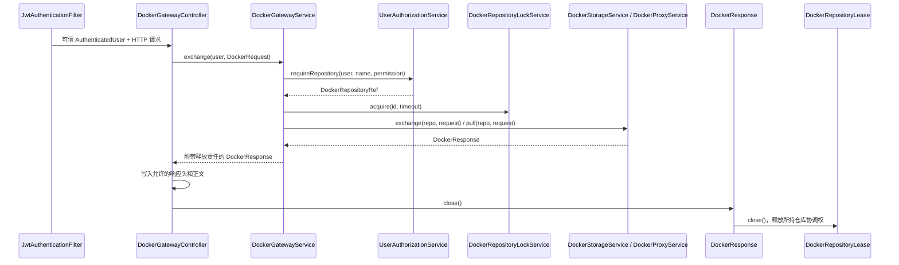

# 001 - Docker 客户端网关与仓库入口

引用：[设计规范](../../DESIGN.md)、[架构](../../ARCHITECTURE.md)、[002 存储与共享模型](002_local_image_storage_design.md)、
[003 代理](003_public_registry_api_proxy_design.md)、[004 清理](004_scheduled_cleanup_design.md)、
[005 身份与授权](005_user_login_design.md)、[Registry API SPEC](../spec/docker-registry-api.md)。

## Context

向 Docker 客户端提供 `/v2/**` 协议入口，向管理员提供仓库注册和列表，向浏览器提供 Spring 渲染的仓库页面。
协议接入、业务授权、存储通信、数据库和并发协调必须分开，不能集中在一个控制器中。

### 目标类及所属包

| 完整类名 | 唯一职责 | 允许的主要依赖 |
|---|---|---|
| `com.grallum.application.controller.DockerGatewayController` | 绑定 Docker HTTP 请求，生成类型化输入，写协议响应 | DockerGatewayService |
| `com.grallum.application.controller.DockerRepositoryController` | 仓库管理 REST 请求和 DTO 校验 | DockerRepositoryService |
| `com.grallum.application.controller.DockerRepositoryPageController` | 仓库列表和详情页面，返回 Thymeleaf 视图 | DockerRepositoryService、DockerImageService |
| `com.grallum.application.service.DockerGatewayService` | 协议用例的授权、模式分发、协调及审计 | UserAuthorizationService、DockerRepositoryService、DockerStorageService、DockerProxyService、DockerRepositoryLockService、AuditService |
| `com.grallum.application.service.DockerRepositoryService` | 仓库注册、可见列表和详情；隐藏持久化对象 | UserAuthorizationService、DockerRepository、DockerProperties、WebProperties |
| `com.grallum.application.service.DockerRepositoryLockService` | 单实例仓库互斥和停机拒绝新工作 | JDK 并发工具，无数据库或 HTTP |
| `com.grallum.application.service.AuditService` | 保存限定字段的业务审计 | AuditEventRepository |
| `com.grallum.application.repository.AuditEventRepository` | audit_event 的参数化 SQL | JdbcClient |
| `com.grallum.application.exception.HttpErrorWriter` | 把业务失败映射为 SPEC 错误 | 无业务或存储依赖 |
| `com.grallum.application.exception.ManagementExceptionHandler` | 管理端点的稳定错误响应 | 无业务或存储依赖 |

DockerRepository、DockerProperties、DockerImageService 和仓库模型由 002 定义；授权、身份和 WebProperties 由 005 定义。
控制器不得依赖 repository 包、JdbcClient、JDK HttpClient 或锁服务，也不得调用其他控制器。

## Contract

数据库定义以 [迁移 SQL](../../application/src/main/resources/db/migration/) 为唯一依据。
下文 entity 描述限定 Java 数据契约和使用方式，不另行定义数据库列语义。

### HTTP 方法与业务分发

协议方法和状态码引用 [SPEC 方法表](../spec/docker-registry-api.md#supported-operations)；权限和模式限制由本设计定义。

| 请求 | Controller → Service | 约束 |
|---|---|---|
| `GET/HEAD /v2/` | DockerGatewayController → DockerGatewayService.ping | 已认证，HEAD 无正文 |
| `GET /v2/_catalog` | DockerGatewayController → DockerGatewayService.catalog | 按当前授权过滤后分页 |
| `/v2/<alias>/<name>/…` | DockerGatewayController → DockerGatewayService.exchange | 按操作类型判权，不只依据 HTTP 方法 |
| `GET /api/repositories` | DockerRepositoryController.list → DockerRepositoryService.list | 只列当前可见仓库 |
| `POST /api/repositories` | DockerRepositoryController.create → DockerRepositoryService.create | 系统管理员，校验配置 alias |
| `GET /repositories` | DockerRepositoryPageController.list → DockerRepositoryService.list | 返回 repositories/list 模板 |
| `GET /repositories/{id}` | DockerRepositoryPageController.detail → DockerRepositoryService.detail | 当前 READ，返回 repositories/detail 模板 |

同一列表/详情服务供 REST 和页面调用；浏览器写操作遵循 005 的 CSRF 规则。

### Registry 协议集成与业务限制

镜像字节由 Distribution 管理，PostgreSQL 只保存应用元数据。部署限单实例，存储端点位于内部网络。
PRIVATE 提供本地存储，PROXY 提供公共镜像只读代理和缓存；公共代理禁止客户端写入。
001 使用 005 提供的身份与授权，选择 002 存储或 003 代理；004 与在线请求共享仓库协调机制。
管理页面采用 Spring MVC 和 Thymeleaf，与 REST 和定时入口共享业务服务。

外部 `<name>` 固定为 `<alias>/<repository>`，例如 `private/team/app`、`dockerhub/library/alpine`。
alias 只能选择可信配置中的后端；repository 必须已注册且已授权。外部链接保留 alias，后端路径才去掉 alias。
公共地址来自可信配置，不能使用任意 Host 或转发头构造认证地址；内部存储地址不可对外暴露。

Registry 只接受 REGISTRY audience 的 JWT。浏览器 Cookie、MANAGEMENT JWT 和资源请求 Basic 均不能替代。
令牌交换地址为 `/auth/registry/token`，service 为 `grallum-registry`；Basic 仅用于 HTTPS 令牌交换。
每次操作同时校验当前账号/授权与 token scope。pull 对应 READ，push 对应 WRITE，delete 对应 MANAGE；
WRITE 包含 READ，MANAGE 包含 WRITE。管理员仍受仓库模式限制，权限撤销不等待 JWT 过期。

下表保留业务操作与授权的完整映射。P 表示 PRIVATE，P/C 表示 PRIVATE 或 PROXY。
技术路由、状态码和头部语义见 [SPEC](../spec/docker-registry-api.md#supported-operations)。

| Method | Path below `/v2/` | Success | Required permission | Mode |
|---|---|---|---|---|
| GET, HEAD | empty path | 200 | Authenticated identity | P/C |
| GET | `_catalog` | 200 | Filter by current READ grants | P/C |
| GET | `<name>/tags/list` | 200 | READ / pull | P/C |
| GET, HEAD | `<name>/manifests/<reference>` | 200 | READ / pull | P/C |
| PUT | `<name>/manifests/<reference>` | 201 | WRITE / push | P |
| DELETE | `<name>/manifests/<digest>` | 202 | MANAGE / delete | P |
| GET, HEAD | `<name>/blobs/<digest>` | 200; ranged GET 206 | READ / pull | P/C |
| DELETE | `<name>/blobs/<digest>` | 202 | MANAGE / delete | P |
| POST | `<name>/blobs/uploads/` | 202; completed mount 201 | WRITE / push | P |
| GET | `<name>/blobs/uploads/<uuid>` | 204 | WRITE / push | P |
| PATCH | `<name>/blobs/uploads/<uuid>` | 202 | WRITE / push | P |
| PUT | `<name>/blobs/uploads/<uuid>?digest=<digest>` | 201 | WRITE / push | P |
| DELETE | `<name>/blobs/uploads/<uuid>` | 204 | WRITE / push | P |


上传状态 GET 和取消 DELETE 属于 WRITE 工作流；取消上传不要求 MANAGE。
对 PROXY 的已认证 `/v2/` 写入返回 405/UNSUPPORTED；本地缓存删除通过独立管理用例，不修改公共上游。
删除 manifest 使用摘要，不接受标签；物理空间回收为离线操作，不直接删除共享 blob 文件。

跨仓库 mount 同时要求源 READ/pull 与目标 WRITE/push，并且后端兼容；否则回退普通上传且不泄露源是否存在。
from 使用外部带 alias 的名称，只能在校验后转换后端路径，不能把未经检查的 from 传给 Distribution。

catalog 是当前用户已授权的注册仓库列表，不是未经筛选的后端目录；名称带 alias。
PROXY 标签列表仅展示本地已知缓存，不列举全部上游标签。先筛选授权，再构造分页、游标和计数。
分页默认 100、上限 1000，非法或超范围返回 400；n/last 按字典序，仍有可见页时返回 Link。
分页不承诺并发快照，游标不能切换后端或提供任意 URL。

未认证时，无论仓库是否存在均返回同样的 challenge；有效身份缺权限返回 403，不泄露内部错误。
公共重定向与上游凭据由代理内部处理，客户端凭据不转发到公共上游。
业务验收覆盖权限撤销、模式限制、alias 混淆、目录隐藏、缓存 miss/hit 和本地淘汰不修改上游。
协议验收使用同一组场景分别验证 JVM 与 Native。

### 精确 Java 方法声明

以下声明限定调用接口；完整构造器、私有成员和有效框架注解同样必须遵守 [设计规范](../../DESIGN.md#contract-completeness)。
类型包归属由本设计或引用设计定义，不能使用跨层持久化容器代替业务类型。

| 类 | 方法声明 | 参数、结果和副作用 |
|---|---|---|
| DockerGatewayController | `public void handle(HttpServletRequest request, HttpServletResponse response, AuthenticatedUser user) throws IOException;` | Servlet 适配层；user 来自可信安全上下文；负责最终关闭服务响应 |
| DockerRepositoryController | `public PageResponse<DockerRepositoryResponse> list(AuthenticatedUser user, PageQuery page);` | 只绑定参数并调用服务 |
| DockerRepositoryController | `public DockerRepositoryResponse create(AuthenticatedUser user, DockerRepositoryRequest request);` | 校验 DTO，返回服务结果，不执行 SQL |
| DockerRepositoryPageController | `public String list(AuthenticatedUser user, PageQuery page, Model model);` | 放入 repositories 视图数据 |
| DockerRepositoryPageController | `public String detail(AuthenticatedUser user, long repositoryId, Model model);` | 放入 repository 视图数据 |
| DockerGatewayService | `public DockerResponse ping(AuthenticatedUser user, boolean head);` | 校验当前身份，不访问镜像后端 |
| DockerGatewayService | `public PageResponse<String> catalog(AuthenticatedUser user, PageQuery page);` | 仓库名转换为 alias/name；复用可见列表服务 |
| DockerGatewayService | `public DockerResponse exchange(AuthenticatedUser user, DockerRequest request);` | 校验操作、当前授权、模式，持有仓库协调权，执行存储或代理业务 |
| DockerRepositoryService | `public PageResponse<DockerRepositoryResponse> list(AuthenticatedUser user, PageQuery page);` | 当前账号检查、可见查询和 DTO 映射 |
| DockerRepositoryService | `public DockerRepositoryResponse detail(AuthenticatedUser user, long repositoryId);` | 由授权服务得到允许访问的仓库，返回不含内部 URL 的 DTO |
| DockerRepositoryService | `public DockerRepositoryResponse create(AuthenticatedUser user, DockerRepositoryRequest request);` | 管理员检查；委托 Repository 原子创建仓库与审计，重复注册返回冲突 |
| DockerRepositoryLockService | `public DockerRepositoryLease acquire(long repositoryId, Duration timeout);` | 可中断、有界等待；超时和停机显式失败 |
| DockerRepositoryLockService | `public Optional<DockerRepositoryLease> tryAcquire(long repositoryId);` | 供调度使用；被占用返回空，不排无限队列 |
| DockerRepositoryLockService | `public void stopAccepting();` | 停机拒绝新工作，已有 lease 仍需释放 |
| AuditService | `public void record(AuditEvent event);` | 委托 AuditEventRepository 持久化；Service 不持有事务，不记录正文、凭据和 SQL |
| AuditEventRepository | `public void insert(AuditEventEntity event);` | 仅参数化持久化，无授权或业务判断 |

`HttpServletRequest/Response`、`Model` 仅出现在 controller 方法；service 方法不得使用 Servlet 或 Spring Authentication。
构造器显式注入上表依赖，不暴露可让上层直接执行 SQL/HTTP 的 public 或包级字段。

### 类型定义与所有权

| 完整类型 | 字段或取值 | 不变量 |
|---|---|---|
| `com.grallum.application.dto.DockerRepositoryRequest` | `String registry, String name` | alias 必须来自配置；name 遵循 SPEC |
| `com.grallum.application.dto.DockerRepositoryResponse` | `long id, String registry, String name, DockerRegistryMode mode, String imagePrefix` | 外部镜像地址；无内部存储 URL |
| `com.grallum.application.model.DockerOperation` | TAGS_LIST、MANIFEST_READ/WRITE/DELETE、BLOB_READ/DELETE、UPLOAD_START/STATUS/APPEND/COMPLETE/CANCEL | STATUS/CANCEL 都需要 WRITE；操作与 HTTP 方法组合须符合 SPEC |
| `com.grallum.application.model.DockerHttpMethod` | GET、HEAD、POST、PATCH、PUT、DELETE | 不接受任意字符串扩展 |
| `com.grallum.application.model.DockerRequest` | `DockerRepositoryName repository, DockerOperation operation, DockerHttpMethod method, Optional<String> reference, Optional<String> uploadId, Map<String,List<String>> query, Map<String,List<String>> headers, InputStream body` | 名称规范化；正文只消费一次；保留重复头及不透明上传状态 |
| `com.grallum.application.model.DockerResponse` | `int status, Map<String,List<String>> headers, InputStream body`；实现 AutoCloseable，`public void close();` | close 幂等关闭后端资源和附属 lease；不可重复消费流 |
| `com.grallum.application.model.DockerRepositoryLease` | 仓库持有权，AutoCloseable，`public void close();` | 由锁服务创建；释放线程与持有模型须一致，取消不泄漏锁 |
| `com.grallum.application.model.AuditEvent` | `Instant occurredAt, String actor, String action, String target, String outcome` | 允许的动作及结果，排除秘密 |
| `com.grallum.application.entity.AuditEventEntity` | 审计表字段及持久化 id | repository 内部对象，不作为 HTTP 响应 |
| `com.grallum.application.exception.BusinessException` | `BusinessErrorCode code, String safeMessage` | 运行时业务失败，服务不抛 HTTP ResponseStatusException |
| `com.grallum.application.exception.BusinessErrorCode` | INVALID_INPUT、UNAUTHENTICATED、FORBIDDEN、NOT_FOUND、CONFLICT、UNSUPPORTED、DEPENDENCY_FAILURE、TIMEOUT、UNAVAILABLE、CANCELLED、RATE_LIMITED | 在不同入口映射为对应响应，不携带 SQL 或内部地址 |

共享仓库、分页类型见 002，身份类型见 005。元数据 DTO 可以序列化；流对象不得放入 JSON、日志或实体。

### 授权、资源与错误约定

- UserAuthorizationService 先检查当前账号、签名范围和授权，再允许后端操作；未认证时不泄露仓库是否存在。
- PRIVATE 选择 DockerStorageService，PROXY 选择 DockerProxyService；代理模式写入在网络请求前拒绝。
- 输入流由 Servlet 容器拥有，服务只借用；返回 DockerResponse 的关闭责任交给 controller 的 finally/try-with-resources。
- exchange 在返回前失败时自行释放 lease；返回成功后由 DockerResponse.close 释放。传输完成前不能提前解锁。
- 默认单实例保守协调同仓库请求；PROXY GET 可能回填，必须与清理协调。跨仓库 mount 不满足双向授权和后端兼容时回退普通上传。
- Location/Link 改写到可信公共地址，保留查询状态；不转发客户端 Authorization/Cookie 或后端内部地址。
- 后端成功但观察或审计失败不能伪装为存储回滚；记录待对账故障，不自动重放写操作。

Controller 只负责协议适配，不执行 SQL、后端 HTTP、锁操作或权限策略。
仓库注册与审计要求同一 Repository 事务；跨表原子入口必须先在 Contract 中明确，不能由 Service 持有事务。
业务顺序中的多个持久化调用不能解释为各自独立提交；具体聚合入口属于实施前必须解决的契约项。

## Core Logic

### Docker 请求调用链



身份由 005 建立；路径与方法绑定后形成 DockerRequest，服务仍校验操作与字段组合。
模式选择、授权、观察更新及审计都在服务侧，Controller 仅做 HTTP 转换。

### 仓库与页面调用链

```text
DockerRepositoryController.create
  -> DockerRepositoryService.create
     -> UserAuthorizationService.requireAdministrator
     -> DockerProperties 校验 alias
     -> Repository 原子注册与审计边界（聚合签名须先确认；不能拆成两个独立提交）
     -> DockerRepositoryResponse

DockerRepositoryPageController.list / DockerRepositoryController.list
  -> DockerRepositoryService.list
     -> UserAuthorizationService.requireActive
     -> DockerRepository.findVisible
     -> PageResponse<DockerRepositoryResponse>
```

实体映射在服务内完成，页面和 JSON 使用明确 DTO，不返回 JdbcClient 结果 Map。
模板不访问数据库、实体的敏感字段或内部后端地址。

## Corners

| 边界 | 可观察行为与责任 |
|---|---|
| 空名称、非法方法组合或参数 | INVALID_INPUT，SPEC 400；无后端调用 |
| 未认证、无权限或错误受众 | 401/403；Registry 返回质询而非登录 HTML |
| 空目录 | 空页；授权过滤先于分页，不能泄露隐藏仓库 |
| 锁等待超时或停机 | UNAVAILABLE；未取得 lease 就不能发起后端请求 |
| 后端失败且响应未提交 | 映射 SPEC 的安全 502/503/504 错误 |
| 客户端取消或流中断 | 关闭 DockerResponse，释放 lease；已提交响应不追加 JSON |
| 重复注册 | repository 唯一约束转换为业务 CONFLICT，不暴露 SQL |
| 同仓库并发 | 与清理共用锁服务，锁只由业务入口持有，不由存储服务重复获取 |
| 停机 | 拒绝新 lease，有界等待在途操作，超时关闭资源；不承诺多实例协调 |

验收必须检查包与依赖：controller 禁止 repository/JDBC/HttpClient/锁依赖，service 禁止 Servlet 类型；
同时验证真实 Docker 登录、推拉、续传、多架构、HEAD/Range、分页和取消资源释放。
仅格式 lint 或类名修改不能证明设计已落实。
