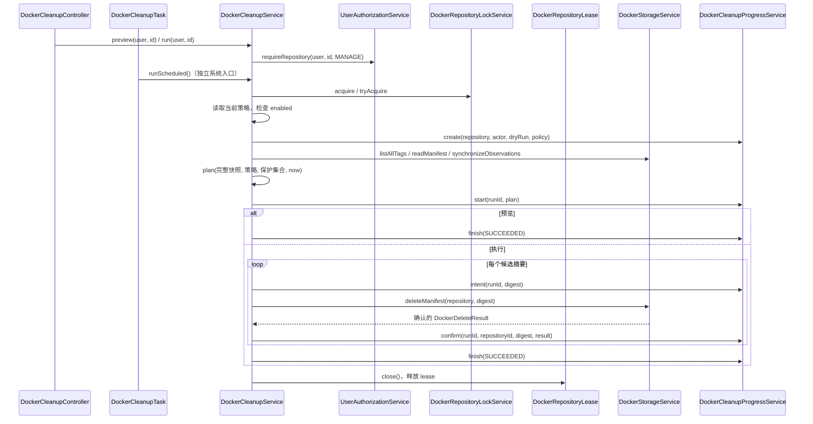

# 004 - Docker 镜像定时清理

引用：[设计规范](../../DESIGN.md)、[架构](../../ARCHITECTURE.md)、[001 仓库协调](001_docker_registry_controller_design.md)、
[002 存储](002_local_image_storage_design.md)、[003 缓存](003_public_registry_api_proxy_design.md)、
[005 身份和权限](005_user_login_design.md)。

## Context

为每个私有或代理仓库提供独立保留策略、预览、执行、定时触发及故障恢复。
清理只删除本地清单引用，不在线回收共享字节，不删除公共上游内容。

### 目标类与所有权

| 完整类名 | 职责 | 主要依赖 |
|---|---|---|
| `com.grallum.application.controller.DockerCleanupController` | 清理与策略 REST 入口 | DockerCleanupService |
| `com.grallum.application.controller.DockerCleanupPageController` | 策略表单、预览和执行结果页面 | DockerCleanupService |
| `com.grallum.application.service.DockerCleanupService` | 权限、策略、快照、候选、删除及恢复用例 | UserAuthorizationService、DockerStorageService、DockerRepositoryLockService、DockerCleanupPolicyRepository、DockerCleanupRunRepository、DockerCleanupProgressService、Clock |
| `com.grallum.application.service.DockerCleanupProgressService` | 协调任务、删除确认和审计；事务由 Repository 持有 | DockerCleanupRunRepository、DockerTagObservationRepository、AuditService |
| `com.grallum.application.task.DockerCleanupTask` | 按时区触发清理和恢复，不包含业务规则 | DockerCleanupService |
| `com.grallum.application.repository.DockerCleanupPolicyRepository` | cleanup_policy 的读取和版本化保存 | JdbcClient |
| `com.grallum.application.repository.DockerCleanupRunRepository` | 任务和逐摘要结果持久化 | JdbcClient |
| `com.grallum.application.config.CleanupProperties` | Cron、时区、批次和关闭期限 | 启动校验 |

纯候选判断是 DockerCleanupService 内的无 I/O 方法，不放在 Controller、Task 或 Repository。
Task 不能查询数据库枚举任务，Controller 不能操作锁，Repository 不能决定哪个镜像应删除。

## Contract

数据库定义以 [迁移 SQL](../../application/src/main/resources/db/migration/) 为唯一依据。
下文 entity 描述限定 Java 数据契约和使用方式，不另行定义数据库列语义。

### 对外 DTO 和业务模型

| 完整类型名 | 字段或取值 | 约束 |
|---|---|---|
| `com.grallum.application.dto.DockerCleanupPolicyRequest` | `int keepLatest, int olderThanDays, String protectedPattern, boolean enabled, long expectedVersion` | 明确校验输入和并发版本 |
| `com.grallum.application.dto.DockerCleanupPolicyResponse` | 相同四项策略值及 `long version` | 没有已保存策略时返回禁用默认值、version=0 |
| `com.grallum.application.dto.DockerCleanupResult` | `UUID runId, boolean dryRun, CleanupRunStatus status, List<String> candidateDigests, List<String> deletedDigests, List<CleanupFailure> failures` | 调用者必须检查 status；不能只看 HTTP 成功 |
| `com.grallum.application.dto.CleanupFailure` | `String digest, String code, String message` | 无密码、SQL、内部地址或不透明上传状态 |
| `com.grallum.application.model.CleanupPolicy` | 四项策略值及 `long version` | 不包含 HTTP/JDBC 类型 |
| `com.grallum.application.model.DockerCleanupPlan` | `Instant capturedAt, long policyVersion, List<String> candidateDigests, List<DockerRetentionDecision> decisions` | 完整快照才可生成，不是客户端可提交的删除命令 |
| `com.grallum.application.model.DockerRetentionDecision` | `String digest, List<String> tags, Set<RetentionReason> reasons, boolean candidate` | 用于预览解释摘要为何受保护 |
| `com.grallum.application.model.RetentionReason` | RECENT_COUNT、AGE、PATTERN、SHARED_DIGEST、INDEX_DEPENDENCY | 纯策略结果，不包含执行状态 |
| `com.grallum.application.model.CleanupRunStatus` | PENDING、RUNNING、SUCCEEDED、PARTIAL、FAILED、SKIPPED | 仅持久化完成的状态才可对外报告 |
| `com.grallum.application.model.CleanupItemStatus` | PLANNED、INTENT、DELETED、ALREADY_ABSENT、UNCERTAIN | 区分删除意图、确认和不确定结果 |
| `com.grallum.application.model.CleanupActor` | `String name, Optional<UUID> userId` | 用户来自安全上下文；无 userId 的系统身份仅由调度/恢复用例建立 |

### 持久化实体

| 完整类型名 | 关键字段和约束 |
|---|---|
| `com.grallum.application.entity.DockerCleanupPolicyEntity` | repositoryId、四项策略值、version；每仓库唯一，版本条件更新 |
| `com.grallum.application.entity.DockerCleanupRunEntity` | id(UUID)、repositoryId、actor、dryRun、policyVersion、policySnapshot、status、startedAt、finishedAt、safeError |
| `com.grallum.application.entity.DockerCleanupItemEntity` | runId、digest、status、confirmedAt、safeError；每任务/摘要唯一 |

实体用于持久化和服务映射，不能直接作为 JSON。开发阶段直接修改对应建表/迁移脚本，保持执行顺序一致。
数据库语义引用 [迁移 SQL](../../application/src/main/resources/db/migration/)；本设计不另行定义列约束。

### HTTP 与 Controller 方法

| HTTP 方法 | 精确 Java 声明 | 语义 |
|---|---|---|
| GET `/api/repositories/{id}/policy` | `public DockerCleanupPolicyResponse policy(AuthenticatedUser user, long repositoryId);` | DockerCleanupController；READ |
| PUT 同路径 | `public DockerCleanupPolicyResponse savePolicy(AuthenticatedUser user, long repositoryId, DockerCleanupPolicyRequest request);` | MANAGE，返回新版本 |
| POST `/api/repositories/{id}/cleanup?dryRun=true` | `public DockerCleanupResult cleanup(AuthenticatedUser user, long repositoryId, boolean dryRun);` | dryRun 缺省 true；MANAGE，false 为执行 |
| GET `/api/repositories/{id}/cleanup/{runId}` | `public DockerCleanupResult result(AuthenticatedUser user, long repositoryId, UUID runId);` | READ，校验任务属于该仓库 |
| GET `/repositories/{id}/cleanup` | `public String page(AuthenticatedUser user, long repositoryId, Model model);` | DockerCleanupPageController；返回 repositories/cleanup |
| POST `/repositories/{id}/cleanup/preview` | `public String preview(AuthenticatedUser user, long repositoryId, Model model);` | 渲染预览，CSRF 保护 |
| POST `/repositories/{id}/cleanup/run` | `public String run(AuthenticatedUser user, long repositoryId, Model model);` | 独立确认表单，CSRF，执行重新判定 |

Controller 只委托服务和映射视图。策略写入必须提交 expectedVersion；调用方先读取 version，冲突时重新读取。

### DockerCleanupService 方法

| 精确声明 | 契约 |
|---|---|
| `public DockerCleanupPolicyResponse policy(AuthenticatedUser user, long repositoryId);` | 当前 READ，Repository 读取或禁用默认值 |
| `public DockerCleanupPolicyResponse savePolicy(AuthenticatedUser user, long repositoryId, DockerCleanupPolicyRequest request);` | 当前 MANAGE；短事务版本化保存及审计，版本冲突为 CONFLICT |
| `public DockerCleanupResult preview(AuthenticatedUser user, long repositoryId);` | 当前 MANAGE；可同步观察及审计，不删除内容 |
| `public DockerCleanupResult run(AuthenticatedUser user, long repositoryId);` | 当前 MANAGE且启用策略；获取协调后重新读取策略和快照 |
| `public DockerCleanupResult result(AuthenticatedUser user, long repositoryId, UUID runId);` | 当前 READ；隔离其他仓库任务 |
| `public void runScheduled();` | 服务内枚举启用仓库，以明确系统身份逐仓库执行，隔离失败 |
| `public void recoverIncompleteRuns();` | 有界读取未完成任务及终态任务中尚未对账的 INTENT，不盲目继续剩余候选 |
| `DockerCleanupPlan plan(List<DockerTag> tags, CleanupPolicy policy, Instant now, Set<String> dependencies);` | 纯函数，无 SQL/网络/锁；不对外接受任意候选删除 |

run/preview 不持有跨存储访问的 SQL 事务。Clock 注入决定 UTC 时间，测试固定时钟。
调度入口属于 Task，SQL 与事务属于 Repository；业务服务只使用已声明的类型化参数。

### 短事务与 Repository 方法

| 所属类 | 精确声明 | 责任 |
|---|---|---|
| DockerCleanupProgressService | `public UUID create(DockerRepositoryRef repository, CleanupActor actor, boolean dryRun, CleanupPolicy policy);` | 委托 Repository 原子保存 PENDING 和策略快照 |
| DockerCleanupProgressService | `public void start(UUID runId, DockerCleanupPlan plan);` | 保存候选并进入 RUNNING |
| DockerCleanupProgressService | `public void intent(UUID runId, String digest);` | 外部删除前提交 INTENT |
| DockerCleanupProgressService | `public void confirm(UUID runId, long repositoryId, String digest, DockerDeleteResult result);` | 委托 Repository 原子确认结果、删除观察和审计 |
| DockerCleanupProgressService | `public void finish(UUID runId, CleanupRunStatus status, String safeError);` | 保存终态；主流程后续失败不能回滚已确认记录 |
| DockerCleanupPolicyRepository | `public Optional<DockerCleanupPolicyEntity> findByRepositoryId(long repositoryId);` | 仅查数据，默认策略由服务提供 |
| DockerCleanupPolicyRepository | `public boolean save(DockerCleanupPolicyEntity policy, long expectedVersion);` | 条件写入，成功递增版本；冲突 false |
| DockerCleanupPolicyRepository | `public List<Long> findEnabledRepositoryIds(long afterId, int limit);` | 有界服务查询，不由 Task 直接调用 |
| DockerCleanupRunRepository | `public void insert(DockerCleanupRunEntity run);` | 持久化任务 |
| DockerCleanupRunRepository | `public Optional<DockerCleanupRunEntity> findById(UUID runId);` | 无权限策略 |
| DockerCleanupRunRepository | `public List<DockerCleanupRunEntity> findUnfinished(int limit);` | 有界恢复批次 |
| DockerCleanupRunRepository | `public void insertCandidates(UUID runId, List<String> digests);` | 保存逐摘要 PLANNED 状态 |
| DockerCleanupRunRepository | `public void updateItem(UUID runId, String digest, CleanupItemStatus status);` | 持久化具体状态，不发起存储删除 |
| DockerCleanupRunRepository | `public List<DockerCleanupItemEntity> findItems(UUID runId);` | 返回任务内有界候选项；数量不超过完整快照上限 |
| DockerCleanupRunRepository | `public void updateStatus(UUID runId, CleanupRunStatus status, Instant finishedAt, String safeError);` | 更新任务结果 |
| DockerCleanupTask | `public void execute();` | 仅调用 DockerCleanupService.runScheduled |
| DockerCleanupTask | `public void recover();` | 仅调用 DockerCleanupService.recoverIncompleteRuns |

ProgressService 是业务协调组件，不持有事务，也不调用外部存储。
Repository 持有短事务；确认删除结果、清理观察和写入审计必须由一个 Repository 聚合入口原子提交。
任务创建、候选及 RUNNING 保存、INTENT、确认和终态是各自明确的提交边界。
现有细粒度 Repository 声明不能替代聚合入口；完整签名、参与写入和失败语义必须在实施前确认。
失败向业务服务传播，不伪造外部存储回滚。CleanupProperties 由 AppConfig 使用 @Value 参数构造。

### 策略不变量和配置

| 项目 | 要求 |
|---|---|
| 数量/年龄 | keepLatest 1～10000，默认 10；olderThanDays 1～36500，默认 30；等于年龄阈值仍保留 |
| 模式/开关 | protectedPattern 非 null、最多 200 字符，默认 latest,stable,release-*；只支持星号通配；enabled 默认 false |
| 保留顺序 | 按观察时间降序、同时间按名称确定顺序；共享摘要任一标签受保护则整体保留 |
| 索引 | 保留多架构依赖，包括未缓存的平台摘要；嵌套缺失/异常时停止删除；深度上限默认 8 |
| 快照 | 只使用完整本地数据；新发现的旧内容从当前观察时间计龄，不按构建日期删除 |
| 调度 | CleanupProperties：cron 默认每天 03:00，zone 必须明确，持久化时间 UTC；恢复批次默认 100 |
| 并发 | 使用 001 的 DockerRepositoryLockService；重叠调度记录 SKIPPED，不无限排队 |
| 结果 | 任务创建后返回类型化终态结果；PARTIAL/FAILED 不得通过 HTTP 200 被描述为业务成功 |

参数/授权/禁用策略等任务创建前失败按公共异常映射；未启用时手动执行 CONFLICT，定时不删除。

## Core Logic

### 入口与执行调用链



图中的手动与调度是互斥入口，不是一次请求同时经过两者。预览与执行都重新读取当前状态，
执行不接收客户端提交的旧计划。候选方法、关键分支和保留不变量均属于实现契约。

### 任务和恢复生命周期

```text
用户或调度触发 → PENDING → RUNNING → SUCCEEDED / PARTIAL / FAILED
调度发现重叠 → SKIPPED
恢复：recoverIncompleteRuns → RunRepository 查询 → 取得仓库 lease
    → DockerStorageService.readManifest 核对已记录 INTENT
    → ProgressService.confirm / finish → 释放 lease
```

只有存储确认的结果才能进入 deletedDigests。部分删除后失败则停止剩余删除，记录 PARTIAL。
崩溃后恢复仅核对已发出的意图，未执行候选不直接续删，防止使用过时策略。
策略或权限在预览后改变时，以执行时重新检查结果为准。

调度开关由 CleanupProperties.schedulingEnabled 在任务触发时检查；不能仅使用 AOT 构建期条件移除 Bean，
否则 Native 产物无法正确遵循运行时的开关。

## Corners

| 情况 | 行为 |
|---|---|
| 空仓库或无候选 | SUCCEEDED、空候选和删除集合、零删除请求 |
| 无策略 | 禁用默认策略；预览可用，执行拒绝 |
| 非法字段或版本冲突 | 400/409，不覆盖他人策略 |
| 元数据不完整或依赖损坏 | FAILED，零删除；不清空旧观察 |
| 用户权限撤销 | 服务重新检查，旧预览不能授权执行 |
| 同仓库重叠 | 手动有界等待，调度跳过并记录；不产生重复删除任务 |
| 外部删除结果未知 | 保留 INTENT/UNCERTAIN，不能标记 DELETED，也不能用 502 当 404 |
| 确认事务失败 | 已发生删除不回滚；恢复先核对实际存储 |
| 单仓库失败 | 保存失败并继续考虑其他仓库，不使全局任务静默终止 |
| 停机 | 停止新调度和后续删除，有界等待在途操作，保留可恢复状态并释放 lease |

验收包括纯策略边界、事务提交顺序、部分失败和崩溃恢复、真实定时触发、并发上传/清理及缓存隔离。
检查 task/controller 无 SQL，Repository 无清理业务决策，所有镜像操作通过 DockerStorageService。
